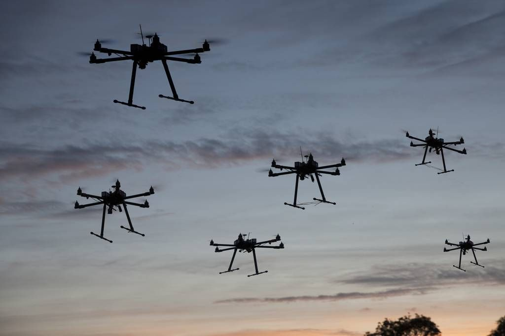
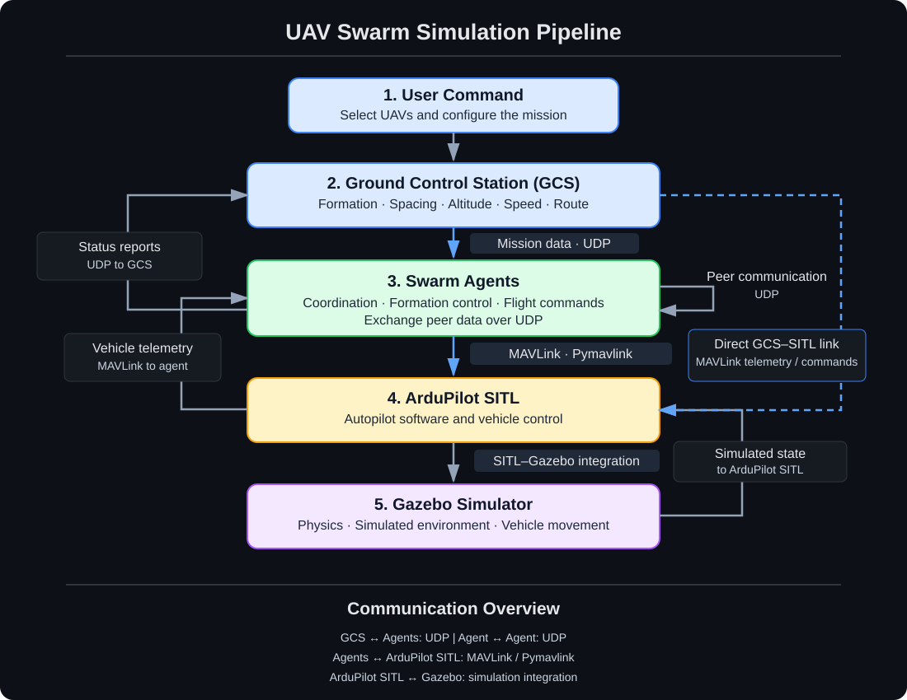
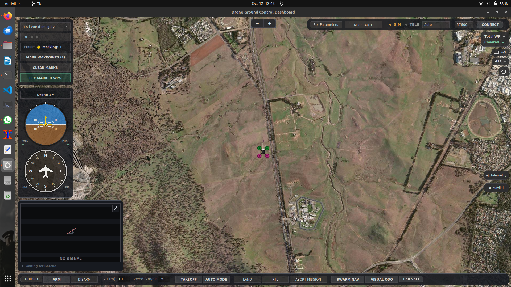
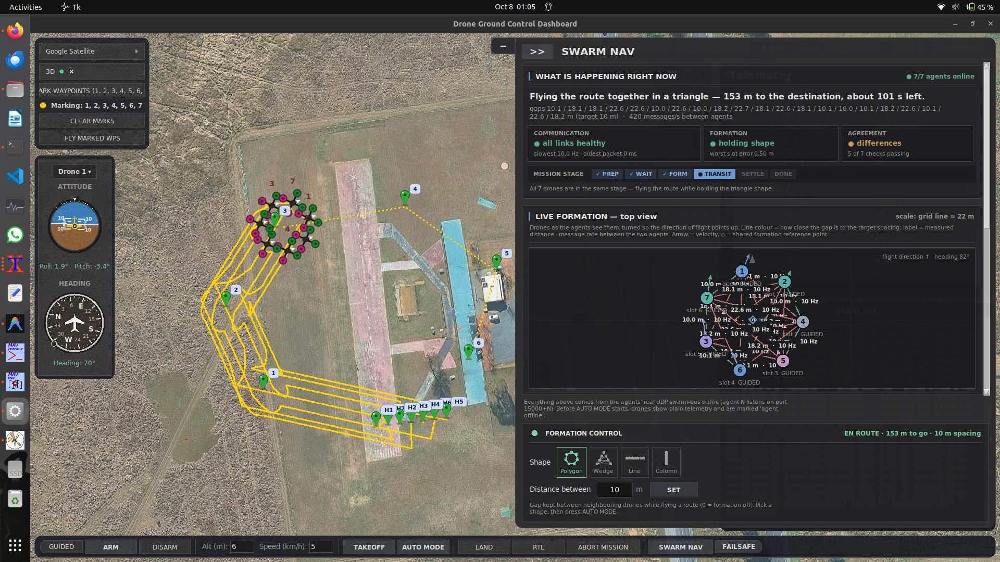
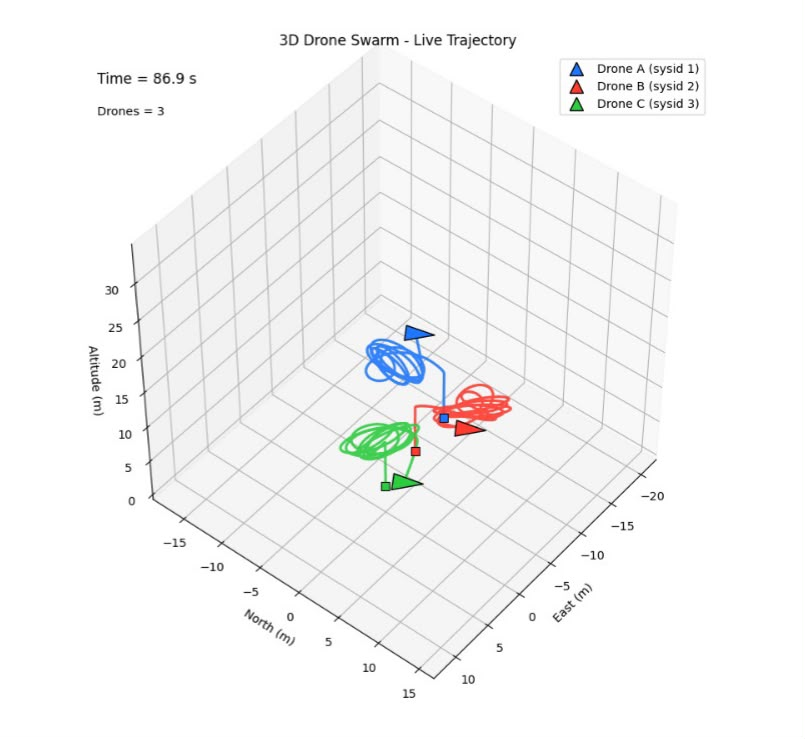
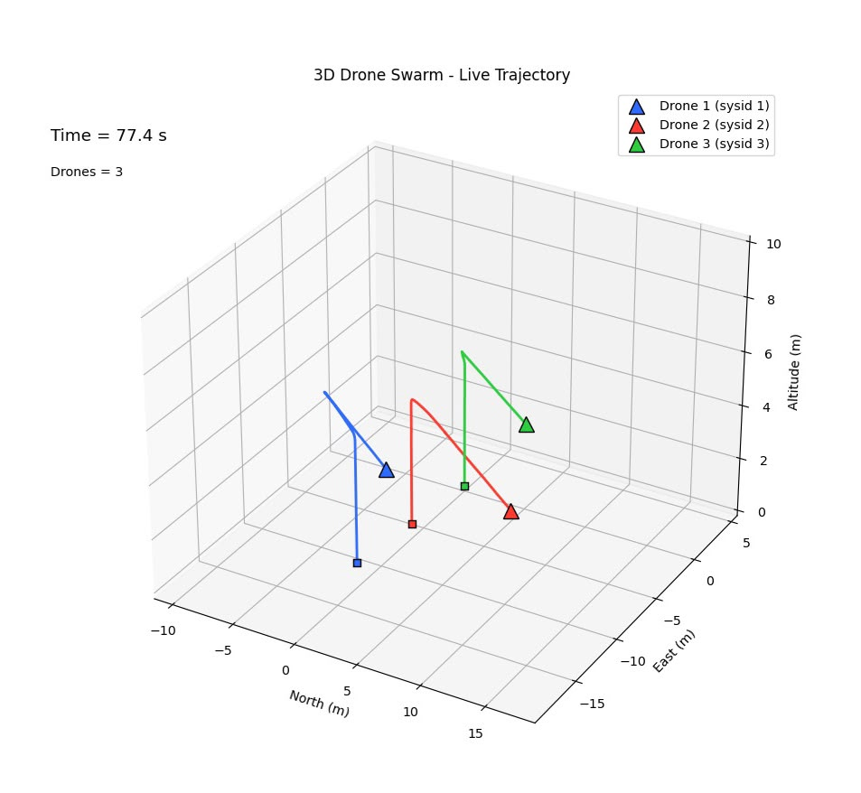
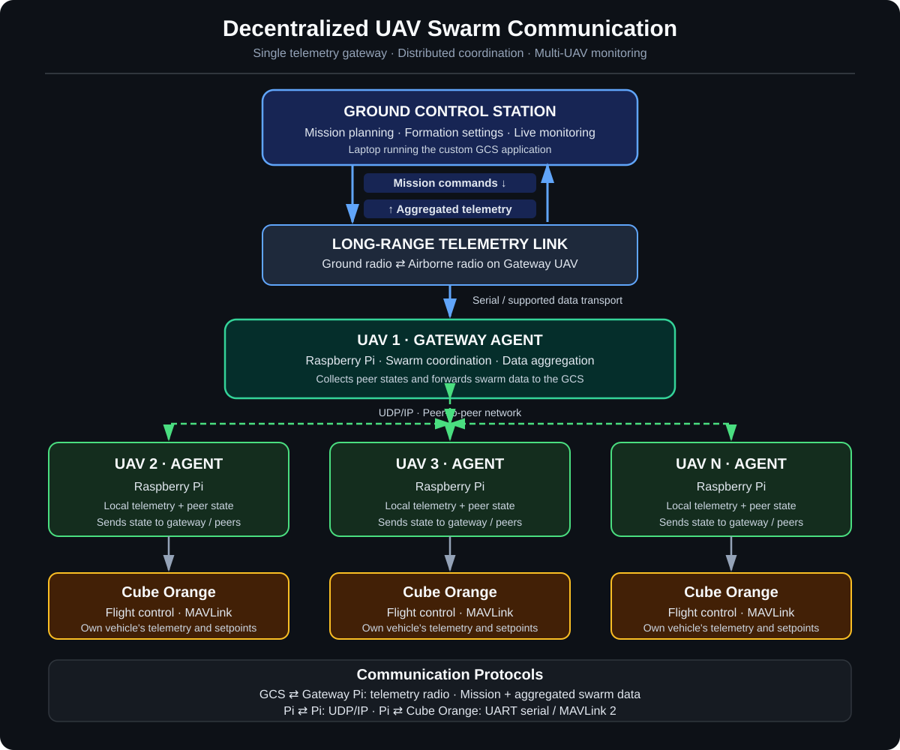

## Decentralized UAV Swarm GCS | Multi-Agent Drone Coordination



**Started:** 15 September 2026

**Goal:** Coordinate multiple simulated UAVs through individual swarm agents and a custom Ground Control Station (GCS).

### Built with


<br clear="right">

## 📌 Overview

A multi-UAV simulation project exploring **decentralized coordination, formation management, and cooperative movement**. It combines ROS 2 Humble, Gazebo, ArduPilot SITL, MAVLink, and a custom GCS.

Each swarm agent manages its own simulated UAV and exchanges state information with other agents. The GCS is used to configure missions and monitor the swarm.

---

##  Simulation Pipeline

The system connects the GCS, swarm agents, ArduPilot SITL, and Gazebo.

<p align="center">
  
</p>

### How it works

1. **Configure mission:** Select UAVs and set formation, spacing, altitude, speed, and route in the GCS.
2. **Distribute mission:** The GCS sends mission data to available agents through the custom UDP swarm bus.
3. **Coordinate agents:** Agents exchange peer-state information over UDP and update their movement references.
4. **Control vehicles:** Each agent uses Pymavlink and MAVLink to send commands to its own ArduPilot SITL instance and receive telemetry.
5. **Simulate flight:** ArduPilot SITL interacts with Gazebo, which simulates vehicle movement and the environment.
6. **Monitor swarm:** Agent states and vehicle telemetry are used by the GCS to display swarm status.

### Communication summary

| Link | Technology | Purpose |
|---|---|---|
| GCS ↔ swarm agents | Custom UDP swarm bus | Mission distribution and status |
| Agent ↔ agent | UDP | Peer-state exchange and coordination |
| Agent ↔ ArduPilot SITL | MAVLink via Pymavlink | Vehicle commands and telemetry |
| ArduPilot SITL ↔ Gazebo | SITL–Gazebo integration | Simulated vehicle and state exchange |
| GCS ↔ ArduPilot SITL | MAVLink | Direct telemetry and supported GCS commands |

> **Implementation note:** The described code uses a custom UDP bus and Pymavlink; it does not use MAVROS. The exact SITL–Gazebo transport depends on the simulation configuration.

---

##  Project Demonstration

### 1. Ground Control Station

<p align="center">
  
</p>

The custom GCS provides mission configuration, swarm monitoring, and simulation management.

### 2. Swarm Agent Interface

<p align="center">
  
</p>

Individual agents manage their vehicle state and formation references, supporting coordinated movement and formation-error correction.

### 3. Multi-UAV Simulation in Gazebo

<p align="center">
  <a href="https://youtu.be/cAJDP-TjUQA">
    
  </a>
</p>

<p align="center">
  **▶️ [Watch the full simulation on YouTube](https://youtu.be/cAJDP-TjUQA)**
</p>

---

##  Swarm Coordination Methods

The current project explores the following methods. Their exact behaviour depends on the agent implementation.

| Method | Role |
|---|---|
| **Permutation-based formation-slot assignment** | Evaluates possible UAV-to-slot assignments and selects a low-cost assignment. |
| **Neighbour-based reference coordination** | Uses information from neighbouring agents to update movement references. |
| **Circular-mean heading coordination** | Averages heading angles correctly around the 0°/360° boundary. |
| **Formation-error-based speed scaling** | Adjusts reference speed in response to formation-position error. |
| **Turn-rate and rotation compensation** | Accounts for formation rotation while the swarm changes direction. |
| **PI-like formation-slot control** | Uses position error to generate corrective movement adjustments. |

### 📚 Research References

These open-access papers provide background for the coordination methods explored in this project.

1. **Distributed UAV Swarm Coordination**  
   *Distributed coordinated control scheme of UAV swarm based on heterogeneous roles* (2022).  
   [Read the full paper — Open Access](https://doi.org/10.1016/j.cja.2021.01.014)  
   **Relevance:** Distributed coordination and formation control for UAV swarms.

2. **Consensus-Based Formation Control**  
   *UAV Formation Obstacle Avoidance Control Algorithm Based on Improved Artificial Potential Field and Consensus* (2021).  
   [Read the full paper — Open Access](https://link.springer.com/article/10.1007/s42405-021-00407-6)  
   **Relevance:** Neighbour-based coordination and consensus for formation control.

3. **Decentralized Formation and Collision Avoidance**  
   Kuriki, Y., & Namerikawa, T. (2015). *Formation Control with Collision Avoidance for a Multi-UAV System Using Decentralized MPC and Consensus-Based Control.*  
   [Read the full paper — Open Access](https://doi.org/10.9746/jcmsi.8.285)  
   **Relevance:** Related approaches to decentralized formation control and collision avoidance.

4. **Assignment Problem — Hungarian Method**  
   Kuhn, H. W. (1955). *The Hungarian Method for the Assignment Problem.*  
   [Read the free PDF](https://www.math.utoronto.ca/mccann/1855/KuhnNRL55.pdf)  
   **Relevance:** Foundational work on minimum-cost assignment. The paper describes the Hungarian method, which is a potential alternative to the project's permutation-based assignment.

> **Note:** These papers are related research, not claims that their complete algorithms have been implemented in this project.

### Formation error analysis

<p align="center">
  
  
</p>

<p align="center">
  <b>Before correction</b>
  &emsp;&emsp;&emsp;&emsp;
  <b>After correction</b>
</p>

The graphs compare formation error before and after correction.

### Coordination sequence

```text
Formation-slot assignment
          ↓
Neighbour-based reference coordination
          ↓
Circular-mean heading coordination
          ↓
Formation-error-based speed scaling
          ↓
Turn-rate / rotation compensation
          ↓
Formation-slot correction
          ↓
Updated agent references and control outputs
```

> **Note:** This is a conceptual sequence; the runtime call order may differ.

---

##  System Architecture

```text
                 ┌──────────────────────────┐
                 │  Ground Control Station  │
                 │          (GCS)           │
                 └────────────┬─────────────┘
                              │
                         MAVLink / UDP
                              │
                ┌─────────────┴─────────────┐
                │                           │
        ┌───────▼────────┐          ┌───────▼────────┐
        │ ArduPilot SITL │          │ ArduPilot SITL │
        │   Vehicle 1    │          │   Vehicle 2    │
        └───────┬────────┘          └───────┬────────┘
                │                           │
        ┌───────▼────────┐          ┌───────▼────────┐
        │  Swarm Agent 1 │◄────────►│  Swarm Agent 2 │
        │  Agent Logic   │          │  Agent Logic   │
        └────────────────┘          └────────────────┘
                │                           │
                └─────────────┬─────────────┘
                              │
                       Additional Agents

                    Gazebo Simulation
```

> **Architecture note:** This is a conceptual overview. Refer to the communication table above for the links described by the current implementation.

---

##  Technology Stack

| Technology | Purpose |
|---|---|
| ROS 2 Humble | Robotics middleware |
| Gazebo | UAV simulation environment |
| ArduPilot SITL | Software-in-the-loop flight simulation |
| MAVLink / Pymavlink | Vehicle commands and telemetry |
| Python | Agent logic and supporting software |
| UDP | Communication between software components |

---

## 🔄 Swarm Communication Pipeline

<p align="center">
  
</p>

---

## 🚧 Development Status

This is an ongoing individual R&D project focused on multi-UAV simulation, formation management, agent coordination, and GCS integration.

**Potential future work**
- Hungarian-algorithm-based formation assignment
- Improved distributed coordination and formation control
- Inter-UAV collision avoidance and cooperative navigation
- More scalable multi-agent architectures
- Integration with physical UAV hardware

These are planned exploration areas, not claims of currently implemented features.

---

##  Project Video

[▶️ Multi-UAV Swarm Simulation](https://youtu.be/cAJDP-TjUQA)

> **Source code:** The repository's source code is not currently public while development continues. Selected implementation details are omitted to protect project intellectual property.
'''

out = Path("/mnt/data/README_refined.md")
out.write_text(readme, encoding="utf-8")
print(f"Created {out} ({len(readme.splitlines())} lines)")
