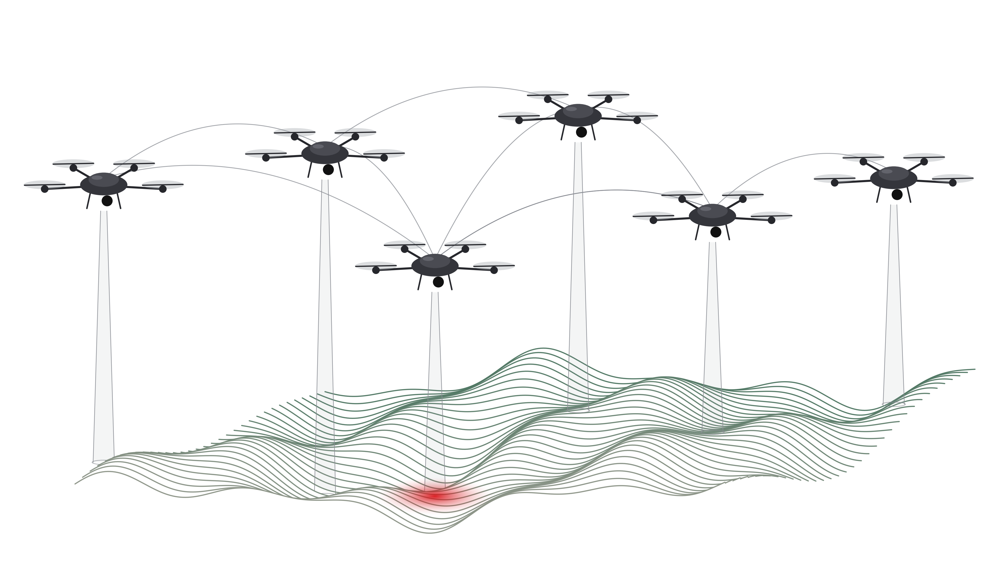

# Decentralized UAV Swarm GCS | Multi-Agent Drone Coordination

<p align="center">
  
  &nbsp;
  
</p>

---

## 📌 Project Overview

This project focuses on developing a **decentralized multi-UAV swarm coordination system** integrating simulated UAVs, individual swarm agents, inter-agent coordination, and MAVLink-based communication.

The system uses **ROS 2 Humble, Gazebo, ArduPilot SITL, and MAVLink** to provide an environment for experimenting with multi-drone coordination, formation management, and distributed control.

The project explores how individual UAV agents can coordinate their reference states, maintain assigned formation slots, synchronize heading behaviour, and respond to changes in formation geometry.

The objective is to develop a modular platform for researching decentralized multi-agent systems, cooperative UAV navigation, and autonomous swarm behaviour.

---

## 🎯 Core Objectives

- Develop a custom Ground Control Station (GCS) for monitoring multiple UAVs.
- Integrate multiple simulated UAVs using ArduPilot SITL and MAVLink.
- Develop individual swarm agents with coordination capabilities.
- Assign and maintain formation slots.
- Coordinate reference movement, heading, and waypoint progression.
- Monitor formation errors and adjust reference speed.
- Account for formation rotation during heading changes.
- Evaluate swarm behaviour in a multi-UAV simulation environment.
- Establish a foundation for future decentralized autonomy research.

---

## 🖥️ Project Demonstration

### 1. Ground Control Station (GCS)

<p align="center">
  
</p>

**Ground Control Station — Monitoring and Simulation Management**

The custom GCS provides an interface for monitoring and managing the multi-UAV simulation. It serves as the main interface for observing swarm activity and interacting with the simulation environment.

The GCS and swarm agents form separate components of the overall system, with their communication and responsibilities determined by the implemented software architecture.

---

### 2. Decentralized Swarm Agent Interface

<p align="center">
  
</p>

**Individual Agents — Coordination and Formation Management**

The swarm-agent component focuses on coordinating multiple UAVs using individual agent logic.

Each agent works with its vehicle state and assigned formation position. The coordination mechanisms explore reference-state updates, heading alignment, formation-error correction, and coordinated movement.

The objective is to maintain the desired formation while the swarm moves and changes direction.

---

### 3. Multi-UAV Simulation in Gazebo

<p align="center">
  <a href="https://youtu.be/cAJDP-TjUQA">
    
  </a>
</p>

<p align="center">
  **▶️ [Watch the Full Multi-UAV Swarm Simulation on YouTube](https://youtu.be/cAJDP-TjUQA)**
</p>

**Simulation — Multi-Agent Coordination in Action**

The simulation demonstrates the multi-UAV environment using Gazebo and ArduPilot SITL, with MAVLink supporting vehicle telemetry and command communication.

It provides a test environment for observing vehicle movement, formation behaviour, and interactions between the simulation and swarm-agent software.

This simulation serves as a foundation for evaluating and improving the coordination mechanisms used by the swarm agents.

---

## 🧠 Swarm Agent Algorithms and Coordination Methods

The swarm agents use a sequence of coordination methods to assign formation positions, coordinate movement, synchronize headings, and maintain formation during flight.

### 1. Formation-Slot Assignment — Permutation-Based Search

**Why is it used?**

When multiple UAVs need to fly in a formation, each UAV must be assigned a specific position, or slot, within that formation.

**How does it work?**

The system evaluates different possible assignments of UAVs to formation slots and compares their total assignment costs. It then selects a low-cost assignment based on the evaluated possibilities.

This helps organise UAVs into the desired formation while reducing unnecessary movement during assignment.

### 2. Neighbour-Based Reference Coordination

**Why is it used?**

Individual UAVs need reference information to coordinate their movement with other agents in the swarm.

**How does it work?**

Each agent uses information from its neighbouring agents to calculate or update its movement reference. This information helps coordinate reference states and waypoint progression across the swarm.

The objective is to achieve coordinated movement through interactions between agents rather than relying entirely on a single central controller for every coordination decision.

### 3. Circular-Mean Heading Coordination

**Why is it used?**

UAV headings are angular values, so directly averaging them can produce incorrect results near the 0°/360° boundary.

For example, headings of 359° and 1° are almost identical, even though their ordinary arithmetic average is 180°.

**How does it work?**

The system calculates a circular mean of the relevant heading angles. This produces a more meaningful average heading and helps agents coordinate their direction of movement.

### 4. Formation-Error-Based Reference-Speed Scaling

**Why is it used?**

During formation movement, individual UAVs may deviate from their desired positions. If the formation continues moving at a fixed reference speed, these deviations may become more difficult to correct.

**How does it work?**

The system monitors formation-position errors and uses them to adjust the reference movement speed according to the implemented scaling rule.

This helps balance formation movement with the need to reduce positional errors.

### 5. Turn-Rate Coordination and Formation-Rotation Compensation

**Why is it used?**

When a moving formation changes direction, its individual slots also need to move around the formation's reference point.

Without accounting for this rotational movement, UAVs may struggle to maintain their relative positions during turns.

**How does it work?**

The coordination logic accounts for formation heading changes and turn-rate information when updating movement references.

This helps the agents coordinate their movement during formation turns and maintain the intended formation geometry.

### 6. PI-Like Formation-Slot Control

**Why is it used?**

Even when formation references are coordinated, individual UAVs may not remain exactly at their assigned positions.

A correction mechanism is needed to reduce the difference between each UAV's actual position and its desired formation slot.

**How does it work?**

The controller uses formation-position error to generate corrective adjustments. Its proportional component responds to the current error, while its integral component, if implemented, accounts for accumulated error over time.

This helps individual agents correct their positions and maintain the desired formation.

---

### 🔄 Overall Coordination Sequence

The coordination process can be summarised as follows:

1. **Assign formation slots:** Determine which UAV should occupy each formation position.
2. **Coordinate reference states:** Use neighbouring-agent information to support coordinated movement.
3. **Synchronize headings:** Calculate a meaningful average heading for directional coordination.
4. **Adjust reference speed:** Use formation errors to regulate reference movement.
5. **Coordinate turns:** Account for formation rotation during heading changes.
6. **Correct formation errors:** Adjust individual UAV movement to reduce deviations from assigned slots.

Together, these methods provide a framework for experimenting with multi-UAV formation management and decentralized coordination in simulation.

> **Development note:** These descriptions represent the intended roles of the coordination methods. Their exact behaviour depends on the current implementation of the swarm agents.

--

## 🔄 Coordination Pipeline

The overall process can be understood as the following sequence:

```text
        ┌─────────────────────────────┐
        │ 1. Formation-Slot Assignment│
        │ Permutation-Based Search    │
        └──────────────┬──────────────┘
                       │
                       ▼
        ┌─────────────────────────────┐
        │ 2. Neighbour-Based Reference│
        │ Coordination                │
        └──────────────┬──────────────┘
                       │
                       ▼
        ┌─────────────────────────────┐
        │ 3. Circular-Mean Heading    │
        │ Coordination                │
        └──────────────┬──────────────┘
                       │
                       ▼
        ┌─────────────────────────────┐
        │ 4. Formation-Error-Based    │
        │ Reference-Speed Scaling     │
        └──────────────┬──────────────┘
                       │
                       ▼
        ┌─────────────────────────────┐
        │ 5. Turn-Rate Coordination   │
        │ and Rotation Compensation   │
        └──────────────┬──────────────┘
                       │
                       ▼
        ┌─────────────────────────────┐
        │ 6. Formation-Slot Correction│
        │ PI-Like Control              │
        └──────────────┬──────────────┘
                       │
                       ▼
        ┌─────────────────────────────┐
        │ Updated Agent References    │
        │ and Control Outputs         │
        └─────────────────────────────┘
```

> **Note:** This diagram represents the conceptual sequence of the coordination methods, not necessarily the exact runtime call order. The actual execution order depends on the implementation.

---

## 🧩 System Architecture

The project combines the GCS, swarm-agent software, ArduPilot SITL vehicles, MAVLink communication, and Gazebo simulation.

```text
                ┌──────────────────────────┐
                │  Ground Control Station  │
                │          (GCS)           │
                └────────────┬─────────────┘
                             │
                       MAVLink / UDP
                             │
               ┌─────────────┴─────────────┐
               │                           │
       ┌───────▼────────┐          ┌───────▼────────┐
       │ ArduPilot SITL │          │ ArduPilot SITL │
       │   Vehicle 1    │          │   Vehicle 2    │
       └───────┬────────┘          └───────┬────────┘
               │                           │
       ┌───────▼────────┐          ┌───────▼────────┐
       │  Swarm Agent 1 │◄────────►│  Swarm Agent 2 │
       │ Agent Logic    │          │ Agent Logic    │
       └────────────────┘          └────────────────┘
               │                           │
               └─────────────┬─────────────┘
                             │
                    Additional Agents
                             │
                     Gazebo Simulation
```

> **Architecture note:** The diagram is conceptual. Ensure that direct agent-to-agent links and GCS connections match the communication paths actually implemented in your project.

---

## 🛠️ Technology Stack

| Technology | Purpose |
|---|---|
| ROS 2 Humble | Robotics middleware |
| Gazebo | UAV simulation environment |
| ArduPilot SITL | Software-in-the-loop flight simulation |
| MAVLink | UAV telemetry and command communication |
| Python | Agent logic and supporting software |
| UDP | Network transport for communication between software components |

---

## 🚧 Development Status

This is an ongoing individual R&D project.

The current development focuses on multi-UAV simulation, formation management, swarm-agent coordination, and GCS integration.

Future development may explore:

- More advanced distributed consensus algorithms
- Hungarian-algorithm-based formation assignment
- Improved formation-control strategies
- Inter-UAV collision avoidance
- Cooperative navigation
- More scalable multi-agent architectures
- Integration with physical UAV hardware

These are potential future improvements and should not be interpreted as already implemented features.

---

## 🎥 Project Video

**Multi-UAV Swarm Simulation:**  
https://youtu.be/cAJDP-TjUQA

> **Note:** The source code has not been made publicly available because the project is currently under active development. Selected implementation details have been omitted to protect the project's intellectual property. Further updates may be shared as development progresses.


## 👨‍💻 Author

**Rakesh Roy**  
B.Tech — Electronics and Communication Engineering

Interests: UAV Systems • Robotics • Embedded Systems • Autonomous Navigation • Multi-Agent Coordination

---
